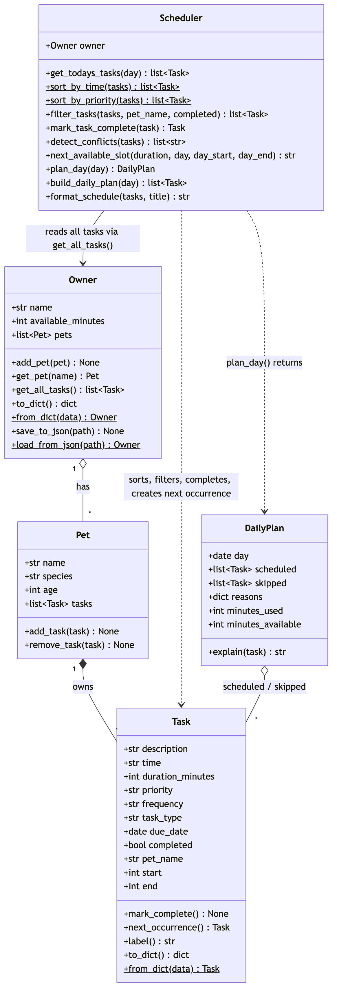

# PawPal+ (Module 2 Project)

You are building **PawPal+**, a Streamlit app that helps a pet owner plan care tasks for their pet.

## Scenario

A busy pet owner needs help staying consistent with pet care. They want an assistant that can:

- Track pet care tasks (walks, feeding, meds, enrichment, grooming, etc.)
- Consider constraints (time available, priority, owner preferences)
- Produce a daily plan and explain why it chose that plan

Your job is to design the system first (UML), then implement the logic in Python, then connect it to the Streamlit UI.

## What you will build

Your final app should:

- Let a user enter basic owner + pet info
- Let a user add/edit tasks (duration + priority at minimum)
- Generate a daily schedule/plan based on constraints and priorities
- Display the plan clearly (and ideally explain the reasoning)
- Include tests for the most important scheduling behaviors

## ✨ Features

- **Multiple pets per owner.** Each pet has its own care tasks: walks, feeding, medication, appointments, grooming and enrichment.
- **Sorting by time.** `Scheduler.sort_by_time()` compares real clock times, so `9:00` comes before `10:30`.
- **Priority scheduling.** `Scheduler.sort_by_priority()` orders high → medium → low, then by time.
- **Filtering.** `Scheduler.filter_tasks()` filters by pet and/or by done / to-do.
- **Conflict warnings.** `Scheduler.detect_conflicts()` flags tasks whose time windows overlap, for one pet or across pets, as friendly warnings rather than errors.
- **Daily and weekly recurrence.** `Scheduler.mark_task_complete()` automatically schedules the next occurrence (`+1 day` / `+7 days`).
- **Time-budgeted, explained daily plan.** `Scheduler.plan_day()` fits the most important tasks into the owner's available minutes and says why each task was kept or skipped.
- **Next available slot.** `Scheduler.next_available_slot()` finds the earliest gap long enough for a new task.
- **Saves between runs.** `Owner.save_to_json()` and `Owner.load_from_json()` store everything in `data.json`. The Streamlit app saves after every change and reloads on start.
- **Friendly output.** Emoji per task type, ✅/⬜ status, color-coded priorities and readable terminal formatting (`Task.label()`, `Scheduler.format_schedule()`).

## 🏗️ Architecture

All logic lives in `pawpal_system.py`. The Streamlit UI (`app.py`) and the CLI demo (`main.py`) only call into it.



Mermaid source: [`diagrams/uml_final.mmd`](diagrams/uml_final.mmd) (also `diagrams/uml.mmd`). The first draft is in [`diagrams/uml_draft.mmd`](diagrams/uml_draft.mmd).

## Getting started

### Setup

```bash
python -m venv .venv
source .venv/bin/activate  # Windows: .venv\Scripts\activate
pip install -r requirements.txt
```

### Suggested workflow

1. Read the scenario carefully and identify requirements and edge cases.
2. Draft a UML diagram (classes, attributes, methods, relationships).
3. Convert UML into Python class stubs (no logic yet).
4. Implement scheduling logic in small increments.
5. Add tests to verify key behaviors.
6. Connect your logic to the Streamlit UI in `app.py`.
7. Refine UML so it matches what you actually built.

## 🧩 Implementation Summary

PawPal+ keeps its logic in `pawpal_system.py`, separate from the Streamlit UI:

- **`Task`** (dataclass): one care activity, with a description, `HH:MM` time, duration, priority, frequency, type, due date and completion status. `mark_complete()` flips its status.
- **`Pet`** (dataclass): a pet's details plus its list of tasks. `add_task()` also stamps the pet's name on the task, so merged schedules know whose task it is.
- **`Owner`**: holds several pets and the minutes available per day. `get_all_tasks()` returns every pet's tasks together.
- **`Scheduler`**: the "brain". It reads tasks only through `Owner.get_all_tasks()`, so it works across all pets, then picks today's tasks and formats the schedule.

`main.py` is a CLI demo that builds an owner with two pets and prints today's schedule.

## 🖥️ Sample Output

Output of `python main.py`:

```

=== Tasks as added (unsorted) ===
⬜ 08:15  🍽️ Breakfast (Mochi, 10 min, high)
⬜ 07:30  🦮 Morning walk (Mochi, 30 min, high)
⬜ 09:00  🩺 Vet check-up (Mochi, 45 min, medium)
⬜ 19:30  ✂️ Brush coat (Mochi, 20 min, low)
⬜ 18:00  🧸 Feather wand play (Luna, 15 min, low)
⬜ 09:00  💊 Thyroid pill (Luna, 5 min, high)

=== Sorted by time ===
📅 Today's Schedule — Jordan
--------------------------------------------------------
⬜ 07:30  🦮 Morning walk (Mochi, 30 min, high)
⬜ 08:15  🍽️ Breakfast (Mochi, 10 min, high)
⬜ 09:00  🩺 Vet check-up (Mochi, 45 min, medium)
⬜ 09:00  💊 Thyroid pill (Luna, 5 min, high)
⬜ 18:00  🧸 Feather wand play (Luna, 15 min, low)
⬜ 19:30  ✂️ Brush coat (Mochi, 20 min, low)

=== Filtered: Luna only ===
⬜ 09:00  💊 Thyroid pill (Luna, 5 min, high)
⬜ 18:00  🧸 Feather wand play (Luna, 15 min, low)

=== Conflict check ===
⚠️ Conflict: 'Vet check-up' (09:00-09:45) overlaps 'Thyroid pill' (09:00-09:05), Mochi and Luna at once.

=== Recurring task: complete Mochi's breakfast ===
Done: ✅ 08:15  🍽️ Breakfast (Mochi, 10 min, high)
Next one created for 2026-10-13: ⬜ 08:15  🍽️ Breakfast (Mochi, 10 min, high)

=== Filtered: still to do today ===
⬜ 07:30  🦮 Morning walk (Mochi, 30 min, high)
⬜ 09:00  🩺 Vet check-up (Mochi, 45 min, medium)
⬜ 09:00  💊 Thyroid pill (Luna, 5 min, high)
⬜ 18:00  🧸 Feather wand play (Luna, 15 min, low)
⬜ 19:30  ✂️ Brush coat (Mochi, 20 min, low)

=== Daily plan (priority first, 90 min available) ===
📅 Today's Plan — Jordan
--------------------------------------------------------
⬜ 07:30  🦮 Morning walk (Mochi, 30 min, high)
⬜ 09:00  💊 Thyroid pill (Luna, 5 min, high)
⬜ 09:00  🩺 Vet check-up (Mochi, 45 min, medium)
  • Morning walk: high priority; fits (30/90 min used)
  • Thyroid pill: high priority; fits (35/90 min used)
  • Vet check-up: medium priority; fits (80/90 min used)
  ✗ Feather wand play: skipped: needs 15 min but only 10 min left today
  ✗ Brush coat: skipped: needs 20 min but only 10 min left today

=== Next available slot ===
Earliest free 20-minute slot today: 07:00
Earliest free 60-minute slot today: 08:00

=== Save & reload (data.json) ===
Saved and reloaded 2 pets and 7 tasks — identical: True
```

## 🧪 Testing PawPal+

```bash
python -m pytest        # add -v to see each test name
```

`tests/test_pawpal.py` has 32 tests covering:

- **Core classes**: `mark_complete()`, adding tasks to a pet, `Owner.get_all_tasks()` across pets, duplicate pet names, case-insensitive pet lookup, and input validation (bad times, priorities, frequencies, durations).
- **Sorting**: chronological order (`"9:00"` before `"10:30"`, which plain string sorting gets wrong), stable order for ties, and priority-then-time.
- **Filtering**: by pet, by completion status, by both, and an unknown pet.
- **Recurrence**: a daily task completed on Jan 31 creates a fresh, incomplete copy for Feb 1 (month boundary); weekly adds 7 days; one-off tasks create nothing; the new task is an independent copy.
- **Conflicts**: exact same time, partial overlap for the same pet, back-to-back tasks that touch but don't overlap, other days and completed tasks ignored, and three tasks at once giving three warnings.
- **Daily plan**: high priority wins within the time budget, skipped tasks are explained, completed and future tasks are excluded, and a zero budget schedules nothing.
- **Edge cases**: an owner with no pets and a pet with no tasks.
- **Extensions**: next available slot (empty day, small gaps, full day, completed tasks ignored) and a JSON save/load round trip that compares every field.

To check the tests themselves, I temporarily broke the code three ways (string-based time sort, back-to-back counted as a conflict, a recurring copy left marked complete). Each change made the matching test fail.

Sample test output:

```
============================= test session starts ==============================
configfile: pytest.ini
testpaths: tests
collecting ... collected 32 items

tests/test_pawpal.py::test_mark_complete_changes_status PASSED           [  3%]
tests/test_pawpal.py::test_adding_task_increases_pet_task_count PASSED   [  6%]
tests/test_pawpal.py::test_owner_collects_tasks_from_all_pets PASSED     [  9%]
tests/test_pawpal.py::test_duplicate_pet_names_rejected_and_lookup_is_case_insensitive PASSED [ 12%]
tests/test_pawpal.py::test_empty_cases PASSED                            [ 15%]
tests/test_pawpal.py::test_invalid_task_fields_rejected[kwargs0] PASSED  [ 18%]
tests/test_pawpal.py::test_invalid_task_fields_rejected[kwargs1] PASSED  [ 21%]
tests/test_pawpal.py::test_invalid_task_fields_rejected[kwargs2] PASSED  [ 25%]
tests/test_pawpal.py::test_invalid_task_fields_rejected[kwargs3] PASSED  [ 28%]
tests/test_pawpal.py::test_invalid_task_fields_rejected[kwargs4] PASSED  [ 31%]
tests/test_pawpal.py::test_invalid_task_fields_rejected[kwargs5] PASSED  [ 34%]
tests/test_pawpal.py::test_time_is_normalized PASSED                     [ 37%]
tests/test_pawpal.py::test_sort_by_time_is_chronological_not_alphabetical PASSED [ 40%]
tests/test_pawpal.py::test_sort_by_time_keeps_insertion_order_for_ties PASSED [ 43%]
tests/test_pawpal.py::test_sort_by_priority_then_time PASSED             [ 46%]
tests/test_pawpal.py::test_filter_by_pet_and_status PASSED               [ 50%]
tests/test_pawpal.py::test_completing_daily_task_creates_next_day_task PASSED [ 53%]
tests/test_pawpal.py::test_completing_weekly_task_creates_task_seven_days_later PASSED [ 56%]
tests/test_pawpal.py::test_completing_one_off_task_creates_nothing PASSED [ 59%]
tests/test_pawpal.py::test_next_occurrence_is_independent_copy PASSED    [ 62%]
tests/test_pawpal.py::test_exact_same_time_is_flagged PASSED             [ 65%]
tests/test_pawpal.py::test_partial_overlap_same_pet_is_flagged PASSED    [ 68%]
tests/test_pawpal.py::test_back_to_back_tasks_do_not_conflict PASSED     [ 71%]
tests/test_pawpal.py::test_conflicts_ignore_other_days_and_completed_tasks PASSED [ 75%]
tests/test_pawpal.py::test_three_overlapping_tasks_give_three_warnings PASSED [ 78%]
tests/test_pawpal.py::test_plan_prefers_high_priority_within_time_budget PASSED [ 81%]
tests/test_pawpal.py::test_plan_skips_completed_and_other_days PASSED    [ 84%]
tests/test_pawpal.py::test_zero_budget_schedules_nothing PASSED          [ 87%]
tests/test_pawpal.py::test_next_available_slot PASSED                    [ 90%]
tests/test_pawpal.py::test_next_slot_ignores_completed_tasks PASSED      [ 93%]
tests/test_pawpal.py::test_json_round_trip PASSED                        [ 96%]
tests/test_pawpal.py::test_load_missing_file_raises PASSED               [100%]

============================== 32 passed in 0.04s ==============================
```

**Confidence level: ★★★★☆ (4/5).** Every scheduling rule above is tested, including the edge cases where it's easiest to slip up. It isn't 5/5 because the Streamlit UI is only checked by hand and with Streamlit's `AppTest`, not in the suite. The greedy planner can also leave unused minutes that a different combination of tasks would have filled.

## 📐 Smarter Scheduling

| Feature | Method(s) | Notes |
|---------|-----------|-------|
| Task sorting | `Scheduler.sort_by_time()`, `Scheduler.sort_by_priority()` | Sorts by minutes after midnight (via `Task.start`), not raw strings, so `"8:15"` comes before `"10:00"`. Priority sort: high → medium → low, then by time. |
| Filtering | `Scheduler.filter_tasks(tasks, pet_name=..., completed=...)` | Filter by pet (case-insensitive) and/or completion status; `None` means "don't filter on this". |
| Conflict handling | `Scheduler.detect_conflicts()` | Flags tasks whose **time windows overlap** (start + duration) on the same day, whether for the same pet or for different pets (one owner can't be in two places). Returns warning strings and never raises. Sorting first lets it stop early per task. |
| Recurring tasks | `Task.next_occurrence()`, `Scheduler.mark_task_complete()` | Completing a `daily` or `weekly` task automatically adds a fresh copy to the same pet, due `today + timedelta(days=1)` or `weeks=1`. One-off tasks just complete. |
| Daily plan within time budget | `Scheduler.plan_day()` → `DailyPlan` (`build_daily_plan()` returns just the tasks) | Greedy: considers high-priority tasks first and keeps each one that still fits the owner's `available_minutes`. Skipped tasks get a reason (`DailyPlan.explain()`), and the chosen tasks are shown in time order. |
| Input validation | `Task.__post_init__`, `to_minutes()` | Rejects bad times (`"25:00"`), priorities, frequencies and durations; normalizes `"7:30"` to `"07:30"`. |

## 📸 Demo Walkthrough

Run the app with `streamlit run app.py`.

1. **Set up the owner.** In the sidebar, enter your name and how many minutes you have for pet care today (e.g. 90). Changes save automatically to `data.json`.
2. **Add pets.** Open **🐶 Add a pet**, enter a name, species and age (e.g. *Mochi*, dog, 3, then *Luna*, cat, 5). Adding a second pet with the same name is refused with an error message.
3. **Schedule tasks.** In **📝 Schedule a task**, pick the pet, task type, time, duration, date, priority, and whether it repeats (once/daily/weekly). A caption suggests the **next free 30-minute slot**. If the new task overlaps an existing one, a yellow warning appears right away (e.g. *'Morning walk' (08:00–08:20) overlaps 'Thyroid pill' (08:00–08:20), Mochi and Luna at once*).
4. **View the schedule.** **📅 Schedule** shows the chosen day's tasks in a table with status, time range, pet, emoji, color-coded priority and repeat rule. Filter by pet or by To do / Done, and sort by **Time** or **Priority, then time**. A banner shows either the list of conflicts or a green "No conflicts".
5. **Complete a task.** Choose a task under the table and press **✅ Done**. For a daily or weekly task, a confirmation shows the next occurrence that was created (e.g. *🔁 Next one added for Tue Oct 13 at 08:00*). Completing the clashing task also clears the conflict warning.
6. **Get the plan.** **🧠 Today's plan** fills your available minutes with the highest-priority tasks first, lists them in time order with the reason for each, shows a progress bar of minutes used, and lists what didn't fit and why.

The same scheduler behaviors in the terminal (`python main.py`):

```

=== Tasks as added (unsorted) ===
⬜ 08:15  🍽️ Breakfast (Mochi, 10 min, high)
⬜ 07:30  🦮 Morning walk (Mochi, 30 min, high)
⬜ 09:00  🩺 Vet check-up (Mochi, 45 min, medium)
⬜ 19:30  ✂️ Brush coat (Mochi, 20 min, low)
⬜ 18:00  🧸 Feather wand play (Luna, 15 min, low)
⬜ 09:00  💊 Thyroid pill (Luna, 5 min, high)

=== Sorted by time ===
📅 Today's Schedule — Jordan
--------------------------------------------------------
⬜ 07:30  🦮 Morning walk (Mochi, 30 min, high)
⬜ 08:15  🍽️ Breakfast (Mochi, 10 min, high)
⬜ 09:00  🩺 Vet check-up (Mochi, 45 min, medium)
⬜ 09:00  💊 Thyroid pill (Luna, 5 min, high)
⬜ 18:00  🧸 Feather wand play (Luna, 15 min, low)
⬜ 19:30  ✂️ Brush coat (Mochi, 20 min, low)

=== Filtered: Luna only ===
⬜ 09:00  💊 Thyroid pill (Luna, 5 min, high)
⬜ 18:00  🧸 Feather wand play (Luna, 15 min, low)

=== Conflict check ===
⚠️ Conflict: 'Vet check-up' (09:00-09:45) overlaps 'Thyroid pill' (09:00-09:05), Mochi and Luna at once.

=== Recurring task: complete Mochi's breakfast ===
Done: ✅ 08:15  🍽️ Breakfast (Mochi, 10 min, high)
Next one created for 2026-10-13: ⬜ 08:15  🍽️ Breakfast (Mochi, 10 min, high)

=== Filtered: still to do today ===
⬜ 07:30  🦮 Morning walk (Mochi, 30 min, high)
⬜ 09:00  🩺 Vet check-up (Mochi, 45 min, medium)
⬜ 09:00  💊 Thyroid pill (Luna, 5 min, high)
⬜ 18:00  🧸 Feather wand play (Luna, 15 min, low)
⬜ 19:30  ✂️ Brush coat (Mochi, 20 min, low)

=== Daily plan (priority first, 90 min available) ===
📅 Today's Plan — Jordan
--------------------------------------------------------
⬜ 07:30  🦮 Morning walk (Mochi, 30 min, high)
⬜ 09:00  💊 Thyroid pill (Luna, 5 min, high)
⬜ 09:00  🩺 Vet check-up (Mochi, 45 min, medium)
  • Morning walk: high priority; fits (30/90 min used)
  • Thyroid pill: high priority; fits (35/90 min used)
  • Vet check-up: medium priority; fits (80/90 min used)
  ✗ Feather wand play: skipped: needs 15 min but only 10 min left today
  ✗ Brush coat: skipped: needs 20 min but only 10 min left today

=== Next available slot ===
Earliest free 20-minute slot today: 07:00
Earliest free 60-minute slot today: 08:00

=== Save & reload (data.json) ===
Saved and reloaded 2 pets and 7 tasks — identical: True
```

**Screenshot or video** *(optional)*: not included. The walkthrough above and the CLI output show the behavior.
